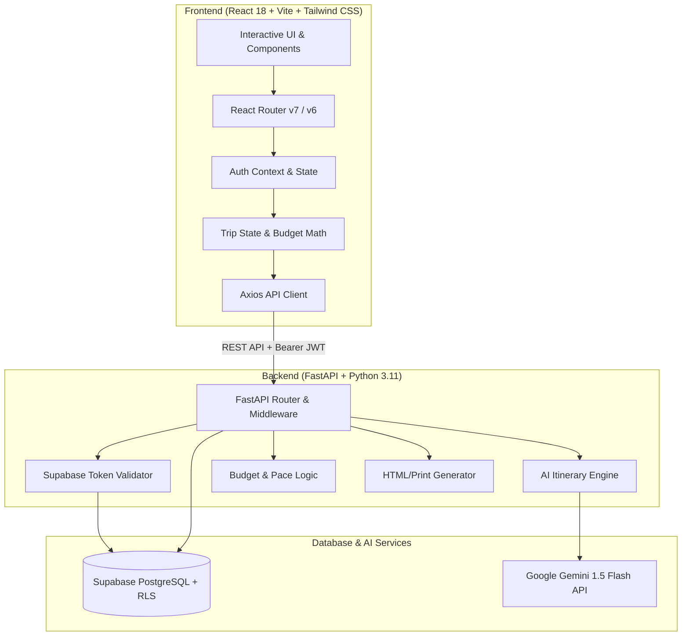

# WanderWise — System Architecture & Design Document

## 1. Overview
WanderWise is a multi-tier, production-ready web application designed for intelligent, personalized travel itinerary planning.



---

## 2. Security Architecture
- **Supabase Auth**: Authenticates users with JSON Web Tokens (JWT).
- **Row Level Security (RLS)**: Enforced directly at the PostgreSQL layer. Every user-facing table (`profiles`, `trips`, `trip_preferences`, `itinerary_days`, `itinerary_activities`) has active RLS policies checking `auth.uid() = user_id`.
- **Zero Frontend Secrets**: Only the Supabase anonymous public key is exposed to the browser. The `GEMINI_API_KEY` and Supabase service-role secrets reside strictly in backend environment variables.
- **Backend Token Verification**: The backend decodes and validates every Bearer token via `supabase.auth.get_user(token)` before performing any query or modification.

---

## 3. Data Model & Schema Normalization

```text
auth.users (Supabase Managed)
    │
    ├── 1:1 ── profiles (full_name, avatar_url, preferences JSONB)
    │
    └── 1:N ── trips (destination, dates, total_budget, currency, pace, style)
                 │
                 ├── 1:N ── trip_preferences (interest tags)
                 │
                 └── 1:N ── itinerary_days (day_number, date, summary, lodging, transit)
                              │
                              └── 1:N ── itinerary_activities (time_slot, title, time, cost, tips)
```

---

## 4. Dual-Engine AI Architecture
- **Production Mode**: Calls Google Gemini (`gemini-1.5-flash`) or OpenAI (`gpt-4o-mini`) using structured prompting with `response_mime_type: "application/json"`. Responses are parsed and strictly validated using Pydantic schemas.
- **Autonomous Demo Mode**: When API keys or database connections are absent, the client and backend automatically activate the deterministic heuristic generator. This generates contextually accurate itineraries (with authentic activities, local tips, transit recommendations, and accurate budget calculations) for any destination on earth without throwing errors.
